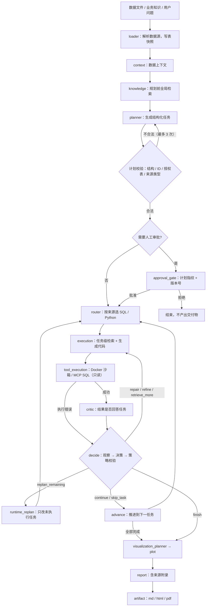
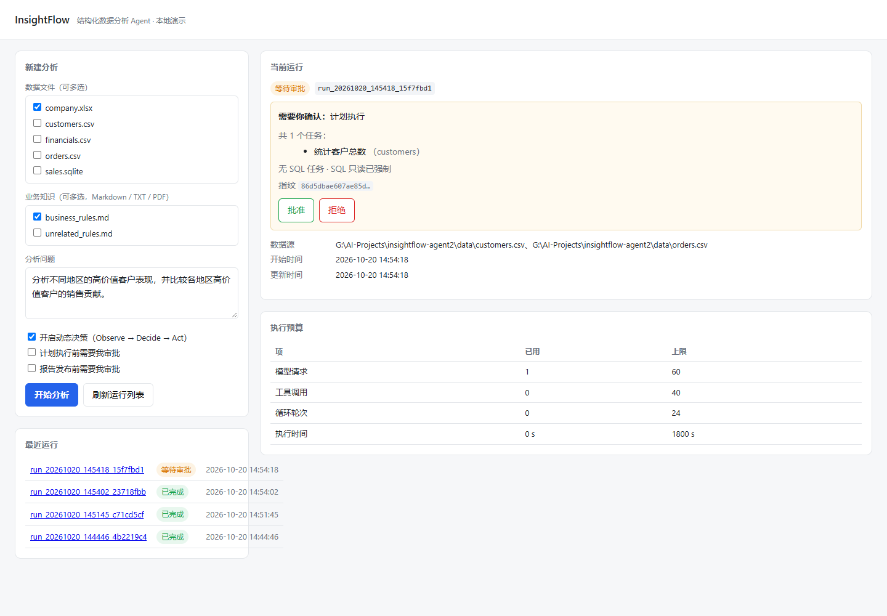

---
[English](#insightflow--agentic-data-intelligence-platform) | [中文](#insightflow--智能数据分析平台)


# InsightFlow — 智能数据分析平台
InsightFlow 是一个基于 LangGraph 和 LangChain 构建的 Agentic 数据分析平台。

用户可以上传结构化数据集以及可选的业务知识文档。InsightFlow 能够自动理解数据、规划分析任务、选择执行工具、生成并执行代码、修复执行错误、验证分析逻辑、生成可视化结果，并最终输出完整分析报告。

## 核心能力

- 支持 CSV、Excel 和 SQLite 多种数据源
- 自适应数据上下文生成
- 多表联合分析与推理
- Business Knowledge RAG
- 基于相似度的知识检索与相关性过滤
- 自动分析任务规划
- Python / SQL 动态工具路由
- 自动代码生成与执行
- Python 与绘图代码在一次性 Docker 容器中执行（只读根、无网络、资源受限）
- 只读 SQL 查询（词法校验 + SQLite Authorizer + 只读连接 + 时间与结果上限）
- SQL 可按运行期配置选择 direct 或经 MCP Server（stdio）执行，两者共用同一套防护
- 执行失败自动 Repair 与 Retry
- 基于 Critic Agent 的分析逻辑验证
- 分析结果自动 Refine
- 基于任务执行结果生成可视化
- 绘图失败自动修复与重试
- 大结果外置到产物文件，按引用安全恢复
- 自动生成 Markdown、HTML 和 PDF 报告
- 基于 FastAPI 的数据与知识文件上传接口
- 按 Run 保存分析产物与运行日志

## Demo 演示

### 自动生成的数据分析报告


## Agentic 工作流

> 图由 `docs/architecture.md` 的同一份结构维护；改动图请直接改这里，不要再引入图片副本。




## 运行时治理层（Harness）

LangGraph 负责状态图、路由、Checkpoint 与人工审批中断；`harness/` 负责一次
**模型调用或工具调用**怎么被执行治理。两层之间只通过少数入口交互，节点不再
直接接触账本、预算计数或工具治理的上下文管理。

| 模块 | 职责 |
| --- | --- |
| `harness/policy.py` | 判定哪些额度、什么时候计数、什么时候结算执行时钟 |
| `harness/llm_gateway.py` | 模型调用的唯一出口：幂等复用 → 预算判定 → 账本 → 按真实请求计数 |
| `harness/tool_dispatcher.py` | Python / SQL / Plot 的统一派发：预算与策略检查 → 授权资源解析 → 错误分类 → 时间结算 |
| `harness/runtime.py` | 组装上述两者，并把当前节点的 state 绑进按执行上下文隔离的 `ContextVar` |

```text
LangGraph 节点 (nodes.py)
    |  HARNESS.model_call / HARNESS.run_tool
    v
harness.llm_gateway / harness.tool_dispatcher
    |                          |
    v                          v
utils.idempotency          utils.middleware.governed_tool_call
utils.llm_retry            tools.tool_registry.invoke_tool
utils.llm_ledger           Docker sandbox / MCP client
    \                          /
     +-- utils.agent_loop（预算状态，随 Checkpoint 持久化）
```

预算只有一份：存在图状态的 `execution_budget` 里，随 Checkpoint 恢复而不重置。
Harness 不重复实现账本、沙箱或 Checkpoint，只固定调用顺序与边界；
`tests/test_harness_architecture.py` 用真实的图执行验证节点确实经过这两条入口。

## 任务级上下文与计划校验

**上下文按任务选，而不是按节点截断。** `harness/context_manager.py` 依据当前
Agent 与当前任务挑出相关表：Planner 看全部授权资源（它要判断可行性），Executor、
Repair、Critic、Refine 只看本任务的表，Plotter 只看图表关联的表。目标表必须是
本次 Run 的真实资源名（`sales.orders`，不是 SQLite 内部的 `orders`），不存在的
表会被明确拒绝。样本行有上限，schema 与行数原样保留——压掉列名只会让模型写出
查不到的字段。

**计划先校验，再执行。** `planning/validator.py` 不调用模型，只按结构化字段判断
计划能否执行：任务形状、`task_id` 唯一性、目标表是否属于本次 Run、来源类型能否
被现有路由落到单一工具（全 sqlite 走 SQL、全 DataFrame 走 Python）。校验失败时
最多重新规划 3 次，次数随 Checkpoint 保存，恢复不会重新给满额度；用尽后以明确
状态收尾，无效计划不会交给 Router 或 Executor。

**审批的是具体的那份计划。** 审批记录里带计划的内容指纹，执行前比对；审批之后
计划被替换会直接拒绝执行，而不是按另一份计划继续。

## 任务级检索、持久化与多轮对话

**知识按任务检索，而不是每次把整个知识库塞进 Prompt。** 规划前仍做一次全局
检索让 Planner 理解业务术语；计划通过校验后，每个任务用自己的问句
（描述 + 期望产出 + 目标表 + 分析重点 + 上一轮问题）检索一次。同一任务的
Executor、Repair、Critic、Refine 复用这批证据，不重复检索。检索结果带
`chunk_id`、文档、页码、分数、`knowledge_version` 与 embedding 模型版本，
报告末尾的来源附录由这些证据生成，不是让模型复述。

分数方向统一为"越大越相关"：进程内索引返回余弦相似度，pgvector 的余弦距离
在检索层换算成 `1 - distance`。两条路径共用绝对阈值，另外要求不低于最高分的
75%，否则一个小知识库里所有片段都会过线，"按任务检索"就退化成"人人一份"。

**两种运行模式**（`INSIGHTFLOW_STORAGE`）：

| | `local`（默认） | `postgres` |
|---|---|---|
| Run 登记 | SQLite 文件 | PostgreSQL `runs` 表 |
| LangGraph Checkpoint | SQLite 文件 | 官方 `PostgresSaver` |
| 知识索引 | 进程内向量库 | pgvector 表 + hnsw 索引 |
| 会话 / 长期记忆 | 同一个 SQLite 文件 | PostgreSQL 表 |
| Redis 缓存 | 可选 | 可选 |

SQLite 模式的旧 Checkpoint 不会被自动迁移到 PostgreSQL：两者表结构不同，
切换后旧 Run 应当继续用 `local` 模式读取。这里不会把不存在的 thread 静默
当成"没有进度"。

**缓存只缓存可重算的东西。** Redis 存查询向量与检索结果，键包含命名空间、
知识版本、问句哈希、embedding 模型版本、`top_k`、阈值与后端；文档一变版本就变，
旧键自然失效。Redis 不可用时回退到持久化索引，但来源缺失、权限不符这类问题
在进缓存之前就抛错，不会被降级绕过。

**会话与记忆是两套东西。** `conversation_sessions/turns/messages` 记录说过什么，
`long_term_memories` 只存经用户确认、可跨会话复用的偏好与定义。新消息创建新的
Turn 与新的 Run；`resume` 只用于继续同一个 Run 的 HITL / Checkpoint。轮次的
展示状态从权威 Run 存储同步，反向不成立；助手消息只在报告真实存在时写入。

记忆写入默认是候选，确认后才注入上下文；明显包含凭据或过长（更像一次分析
结果）的内容会被拒绝。当前没有真实身份认证，`owner` 来自服务端配置的单用户
演示标识——多用户部署必须换成可信身份来源。

### 本地依赖

```bash
docker compose -f deploy/compose.yaml up -d     # PostgreSQL 16 + pgvector、Redis 7
cp .env.example .env                            # 按需填写模型网关与存储配置
```

compose 使用 5433 / 6380，避开本机常见的 5432；`insightflow/insightflow` 是
本地开发默认凭据，不是可直接用于部署的密码。存储健康检查：
`GET /storage/health`。

## 运行期动态决策（H5）

固定编排只能按预设分支走：执行失败就修三次，校验不过就精修三次，修不好就
记失败。这些循环不看"结果到底有没有回答用户的问题"。开启
`enable_dynamic_loop` 后，任务执行完会先观察再决定下一步：

```
tool_execution → (有错) decide → (没错) critic → decide
decide → continue | finish | repair | refine | retrieve_more
       | replan_remaining | skip_task
```

- **观察**由 state 确定性构造：任务目标、工具、成败、错误分类、校验结论、
  结果形状（表/标量/几行/哪些列）、证据引用、剩余预算。不带任何数据行，
  因为它会进 Checkpoint 也会进 Prompt。
- **决策**是一次受治理的模型请求（经 Harness 计数、账本与幂等），返回结构化
  的 `{"action", "reason"}`；**动作由确定性策略校验**：权限、授权、环境与
  预算类错误不允许重试，步数/重规划/补充检索/重复动作都有上限，超出即安全收尾。
- **补充检索**用校验意见或执行错误拼出新问句，只查当前授权的知识库，新旧证据
  按 chunk 去重合并；因为是新的逻辑尝试，执行与复核的操作身份会随之变化，
  否则幂等层会把"再试一次"当成"重放上一次"。
- **运行期重新规划**只重写当前位置及其后的任务：已完成的索引与产物不动，
  新任务要过 H3 同样的校验（资源、结构、依赖），并且与已完成任务 ID 冲突
  直接拒绝。开启计划审批时，修订是**新的一版计划**，会以 `:r<n>` 的审批 ID
  重新中断；拒绝则退回已完成的前缀，绝不执行被拒的任务。
- 关闭开关时图结构不变、路由不变，行为与之前完全一致；开关与各项上限在创建
  Run 时写进 state，恢复后沿用同一份。

代价是真实的：干净任务多一次决策请求；异常任务可能多几次检索或一次修订。
`tests/test_h5_integration.py` 对比了同一任务的开关两种配置，包含"开启后更贵"
这一结论。

## 业务知识 Grounding

InsightFlow 支持使用 Markdown、TXT 和 PDF 等业务知识文档，为数据分析过程提供业务语义和规则约束。

例如，业务知识中可以定义：

> 高价值客户是指所有订单累计购买金额超过 400 美元的客户。

检索得到的业务规则不仅会提供给 Planner，还会贯穿：

```text
Planner
↓
Executor
↓
Repair
↓
Critic
↓
Refine
```

从而避免不同 Agent 在分析过程中自行修改已经明确的业务指标定义。

当前 Business Knowledge RAG 支持：

- 多语言 Embedding 检索
- 知识来源追踪
- PDF 页码追踪
- Similarity Score
- 相关性阈值过滤
- Embedding 模型进程内复用
- Vector Store 缓存

## 使用示例

输入：

```text
数据文件：
- customers.csv
- orders.csv

业务知识：
- business_rules.md

分析问题：
分析不同地区的高价值客户表现，
并比较各地区高价值客户的销售贡献。
```

InsightFlow 会自动完成：

1. 检索与当前问题相关的高价值客户业务定义；
2. 自动生成分析计划；
3. 汇总每位客户的累计购买金额；
4. 根据业务规则识别高价值客户；
5. 比较不同地区的销售表现；
6. 验证执行代码和分析结果是否符合业务规则；
7. 自动生成可视化图表；
8. 输出 Markdown、HTML 和 PDF 分析报告。

## 技术栈

- Python 3.11
- LangGraph
- LangChain
- OpenAI
- Pandas
- SQLite
- FastAPI
- Hugging Face Sentence Transformers
- Matplotlib
- Playwright


## 项目结构

```text
insightflow-agent2/
├── agents/        # 各类分析 Agent
├── agent_loop/    # 运行期观察、动作决策与策略校验
├── planning/      # 计划校验、初始重规划、运行期计划修订
├── harness/       # 执行治理：模型调用、工具派发、预算、上下文选择
├── context/       # 自适应数据上下文
├── ingestion/     # CSV / Excel / SQLite 数据加载
├── knowledge/     # 示例业务知识
├── rag/           # 业务知识检索、证据与缓存
├── storage/       # 会话、长期记忆、知识索引与迁移
├── mcp_bridge/    # MCP Server / Client（stdio）与 Run 级数据授权
├── sandbox/       # Docker 执行沙箱（镜像、宿主执行器、容器入口）
├── services/      # 分析、会话、记忆与知识服务层
├── tools/         # Python / SQL / Plot 工具
├── utils/         # 报告、重试等通用工具
├── docs/          # 架构说明
├── deploy/        # docker compose（PostgreSQL + pgvector、Redis）
├── data/          # 示例数据
├── api.py         # FastAPI 入口
├── api_runs.py    # Run 接口
├── api_conversations.py  # 会话与长期记忆接口
├── main.py        # CLI Demo 入口
├── conditions.py  # 条件路由
├── nodes.py       # LangGraph 节点
├── state.py       # 工作流共享状态
└── workflow.py    # LangGraph 工作流定义
```

主要模块职责：

- `agents/`：负责分析规划、代码生成、错误修复、结果验证、结果优化、可视化与报告撰写
- `agent_loop/`：负责运行期观察、动作决策与确定性策略校验
- `planning/`：负责计划校验、初始重规划与运行期计划修订
- `harness/`：所有模型与工具调用、预算、上下文选择与度量的唯一入口
- `storage/`：负责会话、长期记忆、知识索引与数据库迁移
- `ingestion/`：负责加载 CSV、Excel 和 SQLite 数据
- `context/`：负责生成适合 Agent 使用的数据上下文
- `rag/`：负责业务知识文档加载、切分、Embedding、检索、相关性过滤和缓存
- `tools/`：负责 Python、SQL 和绘图代码的调用与结果归一化
- `sandbox/`：负责 Python 与绘图代码的容器化执行（镜像构建、宿主侧执行器、容器入口）
- `services/`：封装分析、会话、记忆与知识服务，供 CLI 和 FastAPI 共同调用
- `mcp_bridge/`：MCP Server / Client（stdio）与 Run 级数据授权
- `profiling/`：数据画像与 schema 推断
- `deploy/`：本地开发依赖的 docker compose
- `nodes.py`：定义 LangGraph 工作流中的节点逻辑
- `conditions.py`：条件路由（含动态决策的开关分支）
- `workflow.py`：负责节点连接、条件路由和工作流构建
- `state.py`：定义各 Agent 共享的工作流状态
- `api.py`：提供 FastAPI 接口
- `api_runs.py`：Run 创建、查询、恢复与审批接口
- `api_conversations.py`：会话、轮次与长期记忆接口
- `main.py`：提供本地 Demo 启动入口

## 项目结构

```text
insightflow-agent2/
├── agents/        # 各类分析 Agent
├── agent_loop/    # 运行期观察、动作决策与策略校验
├── planning/      # 计划校验、初始重规划、运行期计划修订
├── harness/       # 执行治理：模型调用、工具派发、预算、上下文选择
├── context/       # 自适应数据上下文
├── ingestion/     # CSV / Excel / SQLite 数据加载
├── knowledge/     # 示例业务知识
├── rag/           # 业务知识检索、证据与缓存
├── storage/       # 会话、长期记忆、知识索引与迁移
├── mcp_bridge/    # MCP Server / Client（stdio）与 Run 级数据授权
├── sandbox/       # Docker 执行沙箱（镜像、宿主执行器、容器入口）
├── services/      # 分析、会话、记忆与知识服务层
├── tools/         # Python / SQL / Plot 工具
├── utils/         # 报告、重试等通用工具
├── docs/          # 架构说明
├── deploy/        # docker compose（PostgreSQL + pgvector、Redis）
├── data/          # 示例数据
├── api.py         # FastAPI 入口
├── api_runs.py    # Run 接口
├── api_conversations.py  # 会话与长期记忆接口
├── main.py        # CLI Demo 入口
├── conditions.py  # 条件路由
├── nodes.py       # LangGraph 节点
├── state.py       # 工作流共享状态
└── workflow.py    # LangGraph 工作流定义
```

主要模块职责：

- `agents/`：负责分析规划、代码生成、错误修复、结果验证、结果优化、可视化与报告撰写
- `agent_loop/`：负责运行期观察、动作决策与确定性策略校验
- `planning/`：负责计划校验、初始重规划与运行期计划修订
- `harness/`：所有模型与工具调用、预算、上下文选择与度量的唯一入口
- `storage/`：负责会话、长期记忆、知识索引与数据库迁移
- `ingestion/`：负责加载 CSV、Excel 和 SQLite 数据
- `context/`：负责生成适合 Agent 使用的数据上下文
- `rag/`：负责业务知识文档加载、切分、Embedding、检索、相关性过滤和缓存
- `tools/`：负责 Python、SQL 和绘图代码的调用与结果归一化
- `sandbox/`：负责 Python 与绘图代码的容器化执行（镜像构建、宿主侧执行器、容器入口）
- `services/`：封装分析、会话、记忆与知识服务，供 CLI 和 FastAPI 共同调用
- `mcp_bridge/`：MCP Server / Client（stdio）与 Run 级数据授权
- `profiling/`：数据画像与 schema 推断
- `deploy/`：本地开发依赖的 docker compose
- `nodes.py`：定义 LangGraph 工作流中的节点逻辑
- `conditions.py`：条件路由（含动态决策的开关分支）
- `workflow.py`：负责节点连接、条件路由和工作流构建
- `state.py`：定义各 Agent 共享的工作流状态
- `api.py`：提供 FastAPI 接口
- `api_runs.py`：Run 创建、查询、恢复与审批接口
- `api_conversations.py`：会话、轮次与长期记忆接口
- `main.py`：提供本地 Demo 启动入口

## 操作界面

除了接口和 CLI，服务自带一个零构建的单页控制台：启动后访问 `http://127.0.0.1:8123/ui/`。



它只做四件事——选数据与业务知识、填分析问题、看运行状态与预算、在需要时审批并打开报告。
页面本身是 `web/index.html`（原生 JS，无 CDN 依赖，可离线使用），由 API 挂载在 `/ui`；
配套只有两个只读端点：`/ui-options`（列出 `data/` 与 `knowledge/` 下的示例文件）和
`/runs/{run_id}/report.html`（同一份报告的 HTML 版本）。所有写操作仍走既有接口，
页面不持有任何额外权限。

## API 接口

InsightFlow 基于 FastAPI 提供健康检查、数据分析和报告下载接口。

### 健康检查

```http
GET /health
```

用于检查 API 服务是否正常运行。

示例返回：

```json
{
  "status": "ok"
}
```

### 上传数据并执行分析

```http
POST /analyze/upload
```

执行完整的 InsightFlow Agentic 数据分析流程。

表单参数：

- `files`：一个或多个 CSV、Excel 或 SQLite 数据文件
- `knowledge_files`：可选的 Markdown、TXT 或 PDF 业务知识文件
- `analysis_focus`：可选的自然语言分析目标

例如：

```text
files:
- customers.csv
- orders.csv

knowledge_files:
- business_rules.md

analysis_focus:
分析不同地区的高价值客户表现，
并比较各地区高价值客户的销售贡献。
```

接口返回内容可以包括：

- Run ID
- RAG 检索到的业务知识
- 知识来源、PDF 页码和相似度分数
- 分析计划
- 任务执行结果
- 最终失败任务
- 可视化计划与执行结果
- 最终分析报告
- 生成的图表和报告路径

### 下载分析报告

```http
GET /runs/{run_id}/report
```

用于下载指定分析任务生成的 PDF 报告。

例如：

```text
GET /runs/run_20261008_100352_0e920675/report
```

启动 FastAPI 后可以通过：

```text
http://127.0.0.1:8000/docs
```

打开 Swagger UI，直接测试所有接口。

## 当前限制

当前版本的 InsightFlow 主要面向本地开发、学习和项目演示场景。

目前主要限制包括：

- Vector Store 和缓存目前保存在进程内存中，服务重启后不会持久化。
- 分析请求目前采用同步执行方式，复杂任务需要等待完整工作流结束后才能返回。
- Python 与绘图代码已在一次性 Docker 容器中执行（只读根、无网络、
  资源与并发上限），但容器与宿主共享内核，**不是绝对安全保证**，
  也受限于本机 Docker Desktop 的隔离能力。
- SQL 查询已增加纵深防护（词法校验、SQLite Authorizer、只读连接、
  查询超时与结果行数/字节上限），但**仍在宿主进程内执行**，
  隔离强度低于 Python / Plot 的容器沙箱。
- MCP 已支持：SQL 可经独立 MCP Server 子进程（stdio）执行。
  该 Server 是宿主上的普通进程，**不是安全沙箱**；当前只暴露只读工具，
  传输未实现 HTTP/SSE。
- FastAPI `/runs` 已可选择 SQL 后端：创建时传 `sql_backend`（`direct` 或 `mcp`，
  缺省 `direct`）。模式会随 Run 持久化，恢复时沿用最初保存的值。
  请求**无法**指定 MCP Server 启动命令、私有目录、环境变量或宿主路径；
  mcp 模式不可用时明确失败，不会静默回退 direct。
- 上传文件和生成的分析产物目前保存在本地文件系统。
- 当前 API 暂未实现用户认证、权限控制和多用户隔离，
  因此只能作为**本地演示/开发服务**使用，不得直接公网部署。
- RAG 检索阈值目前基于实验结果设定，还没有经过大规模 Benchmark 验证。

## 后续计划

未来可以进一步扩展：

- 把 SQL 执行迁入受限容器或独立进程
- 持久化向量数据库
- LangSmith 工作流追踪与可观测性
- API 鉴权、限流与多用户隔离
- RAG 与 Agent 分析质量 Benchmark
- 异步分析任务和后台执行
- 实时工作流进度推送
- 基于 DuckDB 的跨数据源分析
- 用户认证与多租户隔离
- 持久化 Artifact 与企业知识存储
- 可配置的 RAG 检索策略与 Reranking


## 安装

### 1. 克隆项目

```bash
git clone https://github.com/shauige66-hash/InsightFlow-Agent2.git
cd InsightFlow-Agent2
```

### 2. 创建 Python 虚拟环境

```bash
python -m venv .venv
```

Windows PowerShell：

```powershell
.\.venv\Scripts\Activate.ps1
```

### 3. 安装依赖

```bash
pip install -r requirements.txt
```

### 4. 配置环境变量

在项目根目录创建 `.env`：

```env
OPENAI_API_KEY=your_openai_api_key
```

也可以选择配置 Hugging Face Token：

```env
HF_TOKEN=your_huggingface_token
```

当前 Embedding 模型不强制要求 `HF_TOKEN`，但配置后可以避免 Hugging Face Hub 匿名请求的速率限制。

### 5. 安装 PDF 报告所需浏览器

InsightFlow 使用 Playwright 生成 PDF 报告：

```bash
playwright install chromium
```

如果本机已经安装 Google Chrome 或 Microsoft Edge，InsightFlow 也可能直接使用本地浏览器。

## 快速开始

### CLI 示例

运行：

```bash
python main.py
```

默认示例会分析：

```text
data/customers.csv
data/orders.csv
```

并使用业务知识：

```text
knowledge/business_rules.md
```

生成的分析产物会保存到：

```text
outputs/<run_id>/
```

包括：

```text
analysis_report.md
analysis_report.html
analysis_report.pdf
chart_*.png
```

### FastAPI

启动 API：

```bash
uvicorn api:app --reload
```

> 该服务**没有鉴权**，只能本机使用，不得直接公网部署。

#### 本地演示（推荐，隔离且不需要模型服务）

用 Mock 模型跑完整工程链路，并把 RunStore / Checkpoint / 产物全部限制在一个
临时目录里，不会碰到真实数据：

```powershell
$env:INSIGHTFLOW_WORKDIR = "$env:TEMP\insightflow-demo"   # 隔离工作目录
$env:INSIGHTFLOW_MOCK_LLM = "1"                            # 不访问任何模型服务
python scripts\serve_api.py --port 8000
```

创建一次 **MCP 后端**的分析：

```powershell
$body = @{
  data_sources   = @("$env:TEMP\insightflow-demo\demo.sqlite")
  analysis_focus = "各区域订单金额"
  sql_backend    = "mcp"          # direct（默认）或 mcp
} | ConvertTo-Json
Invoke-RestMethod -Uri http://127.0.0.1:8000/runs -Method Post `
  -Body $body -ContentType "application/json"
```

`sql_backend` 会随 Run 持久化；`POST /runs/{id}/resume` 恢复时沿用最初保存的值，
请求无法改写它。其他端点（查询状态、计划审批、报告审批、恢复）与请求字段
见 <http://127.0.0.1:8000/docs> 的 OpenAPI 描述。

然后打开：

```text
http://127.0.0.1:8000/docs
```
可以直接上传：

- CSV、Excel 或 SQLite 数据文件
- Markdown、TXT 或 PDF 业务知识文档
- 自然语言分析问题

InsightFlow 会自动执行完整的 Agentic 数据分析流程，并返回分析结果与生成的报告产物。

### 评测与可靠性基准

`eval/` 是一套可重复的评测框架，用来回答两个**分开**的问题：
工作流跑通了吗（完成率），以及算对了吗（正确率）。

```bash
# 完整评测：42 个任务 + 7 个故障注入场景，不访问任何模型服务
python scripts/run_eval.py --output eval/reports

# 只跑某个任务族
python scripts/run_eval.py --family sqlite_join --output eval/reports

# 只跑故障注入场景
python scripts/run_eval.py --faults-only --output eval/reports
```

任务集合覆盖 CSV / Excel / SQLite 三类数据源，以及聚合、过滤、分组、
双键分组、Top-N、极值、去重、连接、比率与统计等算子。
**每个任务的期望值由 `eval/tasks.py` 用纯 Python 独立算出**，
不经过被测工作流的任何代码路径；把答案改错会被判错，有专门的负面用例固定这一点。

故障注入场景验证**出错时的处置语义**：代码异常与 SQL 错误应进入 Repair；
MCP 不可用、数据源缺失属于环境故障，应安全失败而**不**进入 Repair——
把环境故障当代码错误去修只会浪费调用并掩盖真实原因。

输出：`eval.json`（机器可读）、`eval.csv`（逐任务）、`eval.md`（报告）、
`eval.png`（分族完成率/正确率对比图）、`faults.json`（故障场景观测）。

> **评测口径与边界**：当前评测由**脚本化 Mock 模型**驱动**真实工作流**
> ——真实 Docker 沙箱、真实 MCP 子进程、真实 Checkpoint 都是真的，只有 LLM 是 Mock。
> 因此它证明的是**工程链路与判分逻辑**的可靠性，
> **不能**用来声称真实模型的自主分析能力。真实模型指标
> （真实数值正确率、Token 消耗与成本、模糊需求澄清、错误修复成功率、
> 长上下文稳定性）在提供明确授权的 API key 与费用预算之前**均未验证**。
> `scripts/run_eval.py --provider real` 在缺少
> `INSIGHTFLOW_EVAL_REAL_API_KEY` 时会**拒绝执行**并按清单打印所需条件，
> 不会静默调用付费模型。
>
> **不使用真实 Token 计量**：本仓库没有与所用模型匹配的 tokenizer，
> 因此上下文预算以**字符**为准，另给出明确标注为估算的
> `estimated_tokens`（口径 `chars/3.5`），不得当作计费 Token。


# InsightFlow — Agentic Data Intelligence Platform

InsightFlow is an agentic data analysis platform built with LangGraph and LangChain.

Users can upload structured datasets and optional business knowledge documents. InsightFlow autonomously understands the data, plans analytical tasks, selects execution tools, generates and executes code, repairs failures, validates analytical results, creates visualizations, and produces final reports.

## Core Capabilities

- Multi-source data ingestion for CSV, Excel, and SQLite
- Adaptive data context generation
- Multi-table analytical reasoning
- Business Knowledge RAG
- Similarity-based knowledge retrieval and filtering
- Autonomous analysis planning
- Dynamic Python and SQL tool routing
- Code generation and execution
- Python and plotting code executed in one-shot Docker containers
  (read-only root, no network, resource-limited)
- Read-only SQL queries (lexical guard, SQLite authorizer, read-only connection,
  query timeout and result row/byte limits), runnable through a direct host path or
  through an MCP server subprocess over stdio, sharing the same protections
- Automatic execution repair and retry
- Critic-based analytical validation
- Automatic result refinement
- Result-grounded visualization generation
- Plot repair and retry
- Large results externalized into artifacts and safely reloaded by reference
- Markdown, HTML, and PDF report generation
- FastAPI interface with dataset and knowledge-file upload
- Per-run artifacts and execution observability


## Demo & Results

### Automatically Generated Analysis Report


## Agentic Workflow

> The workflow diagram is kept in one place: see the **Agentic 工作流** section
> above (rendered from the same graph) or [docs/architecture.md](docs/architecture.md)
> for the layered view. Keeping a second copy is how the previous diagram went stale.


## Runtime Harness

LangGraph owns the state graph, routing, checkpoints and human-approval interrupts.
`harness/` owns how a single **model call or tool call** is governed. The two layers
meet at a few entry points, so nodes no longer deal with the ledger, request counting
or tool-governance context management directly.

| Module | Responsibility |
| --- | --- |
| `harness/policy.py` | Which budget scopes to check, when to count, when to settle the execution clock |
| `harness/llm_gateway.py` | The only exit for model calls: idempotent reuse → budget check → ledger → count per real request |
| `harness/tool_dispatcher.py` | One dispatch for Python / SQL / Plot: policy check → authorised resource resolution → error classification → time settlement |
| `harness/runtime.py` | Composes the two, and binds the current node's state into a per-execution-context `ContextVar` |

```text
LangGraph nodes (nodes.py)
    |  HARNESS.model_call / HARNESS.run_tool
    v
harness.llm_gateway / harness.tool_dispatcher
    |                          |
    v                          v
utils.idempotency          utils.middleware.governed_tool_call
utils.llm_retry            tools.tool_registry.invoke_tool
utils.llm_ledger           Docker sandbox / MCP client
    \                          /
     +-- utils.agent_loop (budget state, persisted in the checkpoint)
```

There is one budget, held in graph state as `execution_budget` and restored from the
checkpoint rather than reset. The harness does not reimplement the ledger, the sandbox
or the checkpoint; it fixes the order and the boundaries. `tests/test_harness_architecture.py`
drives a real workflow to verify that nodes actually go through these two entries.

## Task-level Context and Plan Validation

**Context is selected per task, not truncated per node.** `harness/context_manager.py`
picks the tables that belong to the current agent and task: the planner sees every
authorised resource (it has to judge feasibility), while the executor, repair, critic
and refine see only their own task's tables and the plotter only the chart's. Target
tables must be real resource names from the run (`sales.orders`, not the SQLite
internal `orders`); unknown tables are refused. Sample rows are capped while schema
and row counts are preserved — dropping column names only makes the model write
queries for columns that do not exist.

**Plans are validated before they run.** `planning/validator.py` calls no model; it
checks structure, unique task ids, whether target tables belong to this run, and
whether the source types can be routed to a single tool (all sqlite to SQL, all
DataFrame to Python). A rejected plan is regenerated at most three times, the count
lives in the checkpoint so a resume cannot refill it, and an exhausted plan ends the
run with an explicit status instead of reaching the router.

**Approval covers one specific plan.** The approval record carries a content
fingerprint, checked again before execution; a plan swapped after approval is refused.

## Runtime Decision Loop (H5)

A fixed graph can only follow its branches: three repairs, three refines, then a
failed task — without ever asking whether the result answered the question. With
`enable_dynamic_loop`, a task is observed before the next step is chosen:

```
tool_execution → (error) decide → (ok) critic → decide
decide → continue | finish | repair | refine | retrieve_more
       | replan_remaining | skip_task
```

Observations are built deterministically from state: goal, tool, success, error
kind, validation verdict, result shape (table/scalar/rows/columns), evidence
refs and remaining budget. No data rows: observations go into the checkpoint and
into a prompt.

Decisions are governed model requests (counted, ledgered, idempotent) that return
a structured action, and a deterministic policy validates it: permission,
authorization, environment and budget failures are never retried, and steps,
replans, extra retrievals and repeated actions are each capped, after which the
run converges safely.

`retrieve_more` re-queries only the authorized knowledge base with a query built
from the critique or the error, merging evidence by chunk id; because it is a new
logical attempt, the execution and review identities change with it — otherwise
idempotency would treat "try again" as "replay the last attempt".

A runtime replan rewrites only the current and remaining tasks. Completed indexes
and artifacts are untouched, new tasks go through the same validation as the
initial plan, and ids colliding with completed tasks are refused. Under plan
approval, a revision is a new plan version with its own `:r<n>` approval id; a
rejection falls back to the completed prefix and the rejected tasks never run.

With the switch off the graph and routing are exactly as before. The switch and
its limits are written into state when the run is created and reused on resume.

The cost is real: a clean task pays one extra decision request, and an abnormal
task may pay for extra retrieval or a replan. `tests/test_h5_integration.py`
compares both configurations on the same task, including where the loop is
strictly more expensive.

## Business Knowledge Grounding

InsightFlow can use business documents such as Markdown, text, and PDF files to ground analytical decisions.

For example, a business rule may define:

> A high-value customer is a customer whose total purchase amount across all available orders exceeds $400.

The retrieved rule is propagated across planning, execution, validation, repair, and refinement so that agents do not silently redefine business metrics.

Knowledge retrieval includes:

- multilingual embedding retrieval
- source tracking
- PDF page tracking
- similarity scores
- relevance threshold filtering
- in-process embedding model reuse
- vector-store caching

## Example

Input:

```text
Data:
- customers.csv
- orders.csv

Business Knowledge:
- business_rules.md

Question:
Analyze the performance of high-value customers across regions
and compare their sales contribution.
```

InsightFlow automatically:

1. retrieves the relevant high-value customer definition,
2. plans the required analyses,
3. aggregates customer purchases,
4. identifies customers exceeding the business threshold,
5. compares regional performance,
6. validates the analytical logic,
7. generates visualizations,
8. produces Markdown, HTML, and PDF reports.

## Tech Stack

- Python 3.11
- LangGraph
- LangChain
- OpenAI
- Pandas
- SQLite
- FastAPI
- Hugging Face Sentence Transformers
- Matplotlib
- Playwright# InsightFlow — Agentic Data Intelligence Platform

InsightFlow is an agentic data analysis platform built with LangGraph and LangChain.

Users can upload structured datasets and optional business knowledge documents. InsightFlow autonomously understands the data, plans analytical tasks, selects execution tools, generates and executes code, repairs failures, validates analytical results, creates visualizations, and produces final reports.

## Installation

### 1. Clone the repository

```bash
git clone https://github.com/shauige66-hash/InsightFlow-Agent2.git
cd InsightFlow-Agent2
```

### 2. Create a virtual environment

```bash
python -m venv .venv
```

Windows PowerShell:

```powershell
.\.venv\Scripts\Activate.ps1
```

### 3. Install dependencies

```bash
pip install -r requirements.txt
```

### 4. Configure environment variables

Create a `.env` file in the project root:

```env
OPENAI_API_KEY=your_openai_api_key
```

An optional Hugging Face token can also be configured:

```env
HF_TOKEN=your_huggingface_token
```

`HF_TOKEN` is not required for the current embedding model, but it can avoid anonymous Hugging Face Hub rate limits.

### 5. Install browser support for PDF reports

InsightFlow uses Playwright to generate PDF reports.

```bash
playwright install chromium
```

If Google Chrome or Microsoft Edge is already available, InsightFlow may use the installed browser automatically.

## Quick Start

### CLI Demo

Run the built-in example:

```bash
python main.py
```

The default demo analyzes:

```text
data/customers.csv
data/orders.csv
```

with business knowledge from:

```text
knowledge/business_rules.md
```

Generated artifacts are stored under:

```text
outputs/<run_id>/
```

including:

```text
analysis_report.md
analysis_report.html
analysis_report.pdf
chart_*.png
```

### FastAPI

Start the API server:

```bash
uvicorn api:app --reload
```

Then open:

```text
http://127.0.0.1:8000/docs
```

The interactive API interface allows you to upload:

- CSV, Excel, or SQLite datasets
- Markdown, TXT, or PDF business knowledge documents
- a natural-language analysis question

InsightFlow then runs the complete agentic analysis workflow and returns the analysis results and generated artifacts.

## Evaluation & Reliability Benchmark

`eval/` is a reproducible harness that answers two **separate** questions:
did the workflow complete, and did it compute the right answer?

```bash
# Full run: 42 tasks plus 7 fault-injection scenarios, no model services contacted
python scripts/run_eval.py --output eval/reports

# A single task family
python scripts/run_eval.py --family sqlite_join --output eval/reports

# Fault-injection scenarios only
python scripts/run_eval.py --faults-only --output eval/reports
```

The task set covers CSV, Excel and SQLite sources across aggregation, filtering,
grouping, two-key grouping, top-N, extremes, distinct counts, joins, ratios and
statistics. **Every expected answer is computed in `eval/tasks.py` with plain
Python**, without going through the code under test, and a wrong answer is
scored wrong — dedicated negative cases pin that down.

The fault-injection scenarios check failure handling rather than happy paths:
code and SQL errors should enter repair, while an unavailable MCP backend or a
missing data source is an environment fault that must fail safely **without**
repair, since repairing an environment fault only burns calls and hides the cause.

Outputs: `eval.json`, `eval.csv`, `eval.md`, `eval.png` (per-family completion
vs correctness) and `faults.json`.

> **Scope.** The current run is driven by a **scripted mock model** over the
> **real workflow** — the Docker sandbox, MCP subprocess and checkpoints are all
> real, only the LLM is mocked. It therefore demonstrates the reliability of the
> engineering path and of the scoring logic, and it does **not** demonstrate a
> real model's analysis ability. Real-model metrics (numeric accuracy, token cost,
> clarification of ambiguous requests, repair success rate, long-context
> stability) are **unverified** until an explicitly authorised API key and budget
> are provided. `scripts/run_eval.py --provider real` refuses to run without
> `INSIGHTFLOW_EVAL_REAL_API_KEY` and prints what it needs instead of silently
> calling a paid model.
>
> **No real token accounting.** No tokenizer matching the target model is
> available here, so context budgets are expressed in **characters**, with a
> clearly labelled estimate (`estimated_tokens`, method `chars/3.5`) alongside.
> The estimate must not be read as billable token usage.

## Project Structure

```text
insightflow-agent2/
├── agents/
│   ├── planner.py
│   ├── executor.py
│   ├── critic.py
│   ├── repair.py
│   ├── refine.py
│   ├── visualizer.py
│   ├── plotter.py
│   ├── plot_repair.py
│   └── reporter.py
│
├── harness/
│   ├── runtime.py
│   ├── llm_gateway.py
│   ├── tool_dispatcher.py
│   ├── policy.py
│   ├── context_manager.py
│   └── context_sources.py
│
├── profiling/
│   ├── profiler.py
│   └── schema.py
│
├── context/
│   └── context_builder.py
│
├── ingestion/
│   ├── loader.py
│   └── models.py
│
├── knowledge/
│   └── business_rules.md
│
├── agent_loop/   # 运行期观察、动作决策与策略校验
├── planning/     # 计划校验、初始重规划、运行期计划修订
│
├── rag/
│   ├── cache.py
│   ├── cache_key.py
│   ├── chunker.py
│   ├── config.py
│   ├── document_loader.py
│   ├── evidence.py
│   ├── knowledge_service.py
│   ├── retrieval.py
│   ├── retriever.py
│   ├── task_query.py
│   ├── vector_store.py
│   └── versioning.py
│
├── storage/      # 会话、记忆、知识索引与迁移
├── deploy/       # docker compose（PostgreSQL + pgvector、Redis）
│
├── mcp_bridge/
│   ├── contract.py
│   ├── server.py
│   ├── client.py
│   └── registry.py
│
├── sandbox/
│   ├── Dockerfile
│   ├── requirements.lock
│   ├── build_image.py
│   ├── executor.py
│   ├── protocol.py
│   ├── bootstrap.py
│   └── run.py
│
├── services/
│   ├── analysis_service.py
│   ├── conversation_service.py
│   ├── knowledge_service.py
│   ├── memory_service.py
│   ├── run_store.py
│   ├── run_store_postgres.py
│   ├── storage_factory.py
│   └── run_coordinator.py
│
├── tools/
│   ├── python_tool.py
│   ├── sql_tool.py
│   └── plot_tool.py
│
├── utils/
│   ├── agent_loop.py
│   ├── artifacts.py
│   ├── context_budget.py
│   ├── llm_retry.py
│   ├── middleware.py
│   └── ...
│
├── eval/
│   ├── tasks.py
│   ├── scoring.py
│   ├── runner.py
│   └── faults.py
│
├── scripts/
│   ├── serve_api.py
│   └── run_eval.py
│
├── docs/
│   └── architecture.md
│
├── data/
│   ├── customers.csv
│   └── orders.csv
│
├── api.py
├── api_runs.py
├── api_conversations.py
├── main.py
├── conditions.py
├── nodes.py
├── state.py
├── workflow.py
├── requirements.txt
└── README.md
```

Key modules:

- `agents/` — planning, execution, repair, validation, refinement, and visualization agents
- `ingestion/` — CSV, Excel, and SQLite data loading
- `context/` — adaptive dataset context generation
- `rag/` — business knowledge loading, chunking, embedding, retrieval, filtering, and caching
- `tools/` — Python, SQL, and plotting tool invocation and result normalization
- `sandbox/` — containerized execution of Python and plotting code (image build, host executor, container entry point)
- `services/` — reusable analysis service used by CLI and API entry points
- `nodes.py` — LangGraph node implementations
- `workflow.py` — LangGraph workflow construction and routing
- `state.py` — shared workflow state definitions
- `api.py` — FastAPI interface
- `main.py` — local CLI demo entry point

## API Endpoints

InsightFlow exposes a FastAPI interface for health checks, analysis requests, and report retrieval.

### Health Check

```http
GET /health
```

Checks whether the API service is running.

Example response:

```json
{
  "status": "ok"
}
```

### Analyze Uploaded Data

```http
POST /analyze/upload
```

Runs the complete InsightFlow analysis workflow.

Form fields:

- `files` — one or more CSV, Excel, or SQLite data files
- `knowledge_files` — optional Markdown, TXT, or PDF business knowledge files
- `analysis_focus` — optional natural-language description of the analysis goal

Example:

```text
files:
- customers.csv
- orders.csv

knowledge_files:
- business_rules.md

analysis_focus:
Analyze the performance of high-value customers across regions
and compare their sales contribution.
```

The response can include:

- run ID
- retrieved business knowledge
- knowledge source, page, and similarity score
- analysis plan
- execution results
- failed tasks
- visualization plan and results
- final report content
- generated artifact paths

### Download Report

```http
GET /runs/{run_id}/report
```

Downloads the generated PDF report for a completed analysis run.

Example:

```text
GET /runs/run_20261008_100352_0e920675/report
```

Interactive API documentation is available at:

```text
http://127.0.0.1:8000/docs
```


## Limitations

The current version of InsightFlow is designed as a local development and demonstration platform.

Current limitations include:

- Vector stores and caches are maintained in process memory and are not persisted across service restarts.
- Analysis requests are executed synchronously, so long-running workflows block the request until completion.
- Python and plotting code now run in one-shot Docker containers (read-only root, no network,
  resource and concurrency limits), but containers share the host kernel, so this is
  **not an absolute security guarantee** and is bounded by the local Docker Desktop.
- SQL queries are hardened (lexical guard, SQLite authorizer, read-only connection,
  query timeout and result row/byte limits) but still execute **inside the host process**,
  with weaker isolation than the Python/Plot container sandbox.
- MCP is supported: SQL can run through a separate MCP server subprocess over stdio.
  That server is an ordinary host process and is **not a security sandbox**; it currently
  exposes read-only tools only, and HTTP/SSE transports are not implemented.
- The FastAPI `/runs` endpoint can select the SQL backend via `sql_backend`
  (`direct` or `mcp`, defaulting to `direct`). The choice is persisted with the run and
  reused on resume. Requests cannot specify the MCP server command, private directory,
  environment, or host paths, and an unavailable MCP backend fails loudly instead of
  silently falling back to direct.
- Uploaded files and generated artifacts are stored on the local filesystem.
- The current API does not include authentication, authorization, or multi-user isolation,
  so it is intended for **local demo/development use only** and must not be exposed publicly.
- Retrieval thresholds are currently based on empirical testing rather than a large-scale retrieval benchmark.
- Agent execution is bounded by a per-run budget (rounds, tool calls, model requests
  and execution time) held in workflow state. The budget survives a checkpoint resume
  rather than resetting. Exhausting it is classified as an environment failure, so it
  converges to a safe failure instead of entering repair, and the plotting path is
  governed by the same entry point as the Python and SQL tools — a zero tool budget
  means no chart container is started. This is governance over the existing bounded
  loops, not a new dynamic agent loop.
- The time budget counts **execution**, not elapsed wall-clock: time spent waiting for
  a human approval is not charged, and the accumulated figure is carried across a
  resume. `max_llm_calls` counts **upstream model requests**, so retries caused by
  unparsable structured output consume it too; a request is only counted once the
  budget check ahead of it has passed and the ledger has recorded its `started` entry.
- Context passed to each model call is bounded by a **per-node character budget**.
  Fields that carry failure feedback or task constraints (error text, task definitions,
  schema, approvals) are never truncated, which means a payload consisting only of such
  fields can still exceed its budget — a deliberate trade that is covered by tests.
  Token figures are estimates, not metered usage (see the evaluation section).
  Per-call measurements are held per execution context, so concurrently running runs
  cannot attribute one run's figures to another.
- The evaluation harness runs on a scripted mock model. Real-model quality metrics are
  not measured, and provider access is gated behind explicit authorisation.

## Future Work

Planned improvements include:

- moving SQL execution into a restricted container or a separate process
- persistent vector database support
- LangSmith tracing and workflow observability
- API authentication, rate limiting and multi-user isolation
- a real-model evaluation run over the existing harness, once API access and a budget
  are authorised (the harness, scoring and fault injection already exist)
- expanding the task set beyond its current 42 tasks (no time-series, three-table joins,
  or unstructured-text inputs yet)
- asynchronous analysis jobs and background execution
- real-time workflow progress streaming
- cross-source analytical querying with DuckDB
- persistent artifact and knowledge storage
- configurable RAG retrieval strategies and reranking