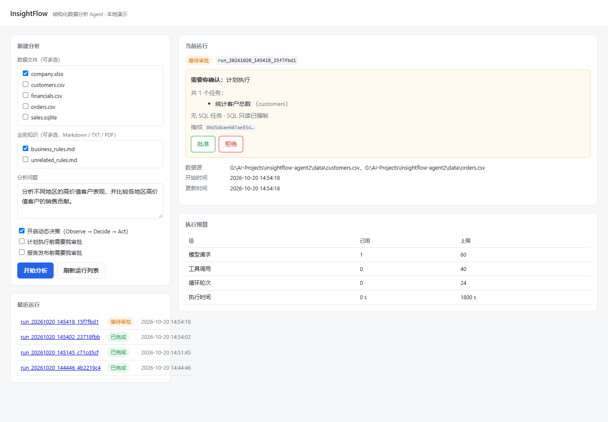
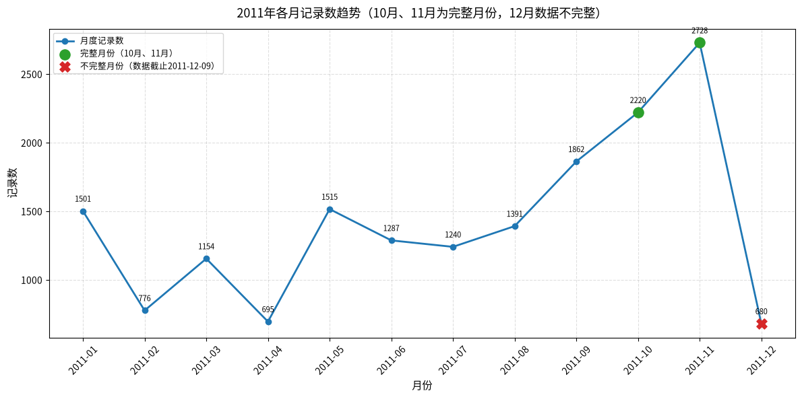
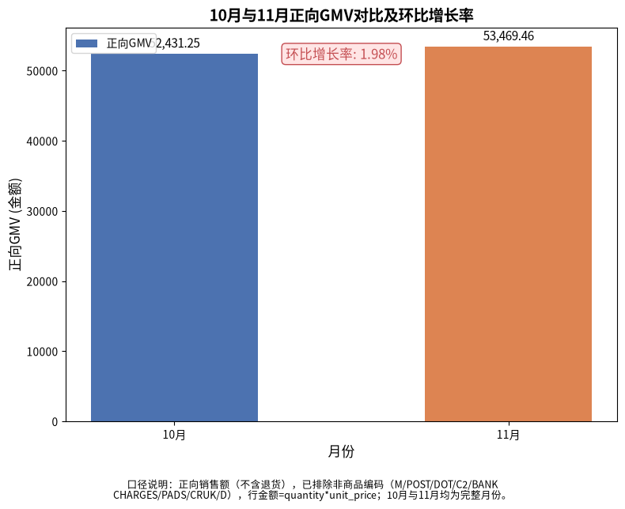
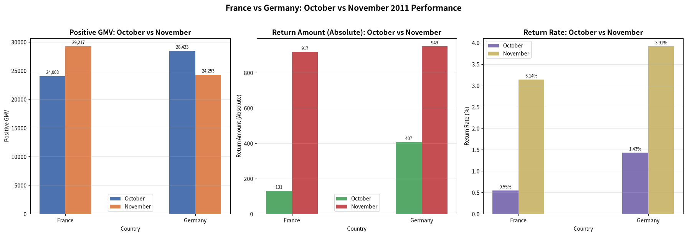

# 真实数据演示手册

这份手册可以照着一步步操作：用仓库自带的零售数据，跑一次完整的周期性经营复盘分析。
所有命令、接口与页面地址都对照当前代码核实过（基准：`main` 分支 `45ca142`）。

> **关于模型调用**：演示需要一次真实的模型 API 调用（分析、校验、绘图代码都由模型生成）。
> 请自行配置模型 API key；本手册不包含任何付费调用，也不假设你已经配好。
> 没有 key 时可以用 Mock 模型验证工程链路（见「环境准备」第 6 步），但 Mock
> **只证明流程能跑通，不能证明模型的分析能力**。

## 1. 演示目标

模拟一名负责德国站与法国站的跨境电商运营，向系统提交订单明细、商品维表和一份业务口径
文档，让系统完成一次经营复盘：算 GMV 环比、找退货最高的商品、算整体退货率、比较两个
市场，并主动报告数据质量问题。最终得到一份带图表、带结论、带知识来源引用的分析报告。

演示重点验证两件事：

1. 业务口径以文档形式传入后，模型的结论会被口径约束（有/无口径对照见 §8）；
2. 数据里的两个陷阱（12 月不完整、非商品编码）是否被主动识别，而不是照算。

## 2. 所需数据文件（仓库自带，无需下载）

| 文件 | 内容 | 规模 |
|---|---|---|
| `data/retail/orders_eu_2011.csv` | 2011 年德国站 + 法国站订单明细 | 17,049 行 |
| `data/retail/products.csv` | 商品维表 | 1,990 个 SKU |
| `knowledge/retail_data_notes.md` | 业务口径文档（统计规则、非商品编码、数据截止日） | Markdown |

明细里另有 177 个带客户编号的客户；脏数据（缺失客户号、零价行、重复发票行）是**故意保留**的，
说明见 [data/retail/README.md](../../data/retail/README.md)。

## 3. 数据来源

UCI Machine Learning Repository 的公开数据集 **Online Retail II**（英国在线零售商
2010-12 至 2011-12 交易记录），本演示只取其中德国与法国市场 2011 年的数据，由
`scripts/prepare_retail_case.py` 从原始文件生成。引用：Chen, D. (2012).
*Online Retail II*. UCI Machine Learning Repository. <https://doi.org/10.24432/C5CG6D>。

**注意区分**：数据是真实公开数据；「德国站/法国站运营人员」是模拟的业务角色；
工作流程是按真实运营习惯复刻的。这不是某家公司的生产环境案例。

## 4. 环境准备

```powershell
# 1) Python 3.11 虚拟环境与依赖
python -m venv .venv
.\.venv\Scripts\Activate.ps1
pip install -r requirements.txt

# 2) 配置模型（三选一填写；.env 不进版本库）
copy .env.example .env
#    编辑 .env：DEEPSEEK_API_KEY / DEEPSEEK_BASE_URL / DEEPSEEK_MODEL
#    存储保持默认 INSIGHTFLOW_STORAGE=local 即可，本演示不需要 PostgreSQL/Redis

# 3) Docker Desktop 保持运行（Python 与绘图代码在一次性容器里执行）

# 4) 构建沙箱镜像（默认 tag：insightflow-sandbox:py311，缺失时执行会报
#    "sandbox image not present locally"）
python sandbox/build_image.py

# 5) 验证模型凭据（一次 4 token 的请求；401=key 无效，402=余额不足，404=base_url 少了 /v1）
python scripts/check_model.py

# 6)（可选，没有真实 key 时）用脚本化 Mock 模型验证工程链路
#    PowerShell 启动前设置：$env:INSIGHTFLOW_MOCK_LLM = "1"
```

PDF 导出依赖浏览器：本机装有 Chrome/Edge 时通常可直接使用，否则
`playwright install chromium`。缺浏览器时**不会失败**，报告降级为
Markdown + HTML，状态记为 `degraded`（见 §10）。

## 5. 启动服务与访问地址

```powershell
python scripts/serve_api.py --port 8123
```

- 控制台（推荐入口）：<http://127.0.0.1:8123/ui/>
- OpenAPI 文档：<http://127.0.0.1:8123/docs>
- 存储健康检查：<http://127.0.0.1:8123/storage/health>（local 模式应显示 sqlite）

`serve_api.py` 会把 RunStore、Checkpoint 与产物目录都限制在工作目录
（默认 `outputs/demo`，可用 `INSIGHTFLOW_WORKDIR` 指定），不碰其他数据。
端口被占用时换一个 `--port` 即可。

## 6. 控制台操作步骤



1. **数据文件**：页面通过 `GET /ui-options` 自动列出 `data/` 与 `knowledge/` 下的文件，
   勾选 `data/retail/orders_eu_2011.csv` 和 `data/retail/products.csv`。
   也可以用自己的文件：「选择文件」会逐个 `POST /api/uploads`（单文件 ≤ 20 MB，
   数据白名单 `.csv/.xlsx/.db/.sqlite/.sqlite3`，知识白名单 `.md/.txt/.pdf`），
   上传成功后返回的服务端路径会自动加入勾选列表。
2. **业务知识文件**：勾选 `knowledge/retail_data_notes.md`。
3. **分析问题**：清空输入框，粘贴 §7 的演示 Prompt。
4. **选项**（默认值来自页面代码）：
   - 「开启动态决策（Observe → Decide → Act）」**默认勾选**；
   - 「计划执行前需要我审批」「报告发布前需要我审批」默认不勾选，勾选后运行会停在
     审批点，页面上出现批准/拒绝按钮（对应接口 `POST /runs/{run_id}/approval`，
     载荷字段见 <http://127.0.0.1:8123/docs> 的 OpenAPI 描述）。
   - 说明：API 层 `enable_dynamic_loop` 默认是 `false`（`api_runs.py`），控制台
     勾选后显式传 `true`——动态决策是**可配置能力**，不是所有运行的必经环节。
5. **API Key**：仅当服务端配置了 `INSIGHTFLOW_API_KEYS` 时需要，在右上角填入并保存
   （存浏览器 localStorage，请求带 `Authorization: Bearer <token>`）。默认本地单用户
   演示模式不需要。
6. 点击**开始分析**：页面 `POST /runs` 创建运行，之后每 2.5 秒轮询状态；
   运行中出现预算卡片（模型请求/工具调用/耗时用量）与决策卡片（动态决策的观察与动作）。
7. 结束后点击**打开报告**（`GET /runs/{run_id}/report.html`）。产物文件在工作目录的
   `<run_id>/` 下：`analysis_report.md`、`analysis_report.html`、`analysis_report.pdf`
   （有浏览器时）、`chart_*.png`。

不想用页面时，等价的一次 API 调用：

```powershell
$body = @{
  data_sources      = @('data/retail/orders_eu_2011.csv', 'data/retail/products.csv')
  knowledge_sources = @('knowledge/retail_data_notes.md')
  analysis_focus    = '（粘贴 §7 的演示 Prompt）'
  enable_dynamic_loop = $true
} | ConvertTo-Json
Invoke-RestMethod -Uri http://127.0.0.1:8123/runs -Method Post -Body $body -ContentType 'application/json'
# 之后 GET /runs/{run_id} 轮询状态
```

## 7. 演示 Prompt

```text
请基于订单明细、商品维表和业务规则文档，对德国站和法国站的经营情况进行完整复盘：

1. 最近两个完整月份的 GMV 及环比变化。
2. 退货金额最高的真实商品。
3. 整体金额退货率。
4. 不同国家市场的经营表现。
5. 数据质量问题和分析限制。
```

## 8. 预期分析结果

**标准答案**（由脚本对仓库数据复算得出，与模型无关）：

| 指标 | 数值 |
|---|---|
| 2011 年 10 月 GMV | 52,431.25 |
| 2011 年 11 月 GMV | 53,469.46 |
| 环比 | 约 **+1.98%**（脚本口径 +2.0%） |
| 退货金额最高的商品 | `22423` REGENCY CAKESTAND 3 TIER，退货 809.70 |
| 整体金额退货率 | **1.76%**（退货 6,479.59 / 销售 368,343.18） |
| 数据截止 | **2011-12-09**（12 月只有 9 天） |

**历史真实运行**（DeepSeek 经 ModelGate，传入 `knowledge/retail_data_notes.md`）：
状态 `completed`，3/3 图表，约 26 次模型请求、95 秒；报告正确选用了 10→11 月作为
唯一可比的完整月份，退货冠军 `22423`，并明确写出已排除 `M/POST` 等非商品编码。
历史运行产出的三张图表：





**必须说明的边界**：

- 上表标准答案是**这份数据的历史复算结果**，不构成对任何一次模型运行准确率的保证。
  真实模型输出有波动：数值可能四舍五入口径不同，图表数量可能少于 3——当前代码对
  图表**逐张校验**（来源任务必须成功、图表类型合法、目标表匹配），不合法的图表会被
  拒绝并写入报告的「未能生成的图表」附录，而不是硬凑。
- 季度比较涉及 Q4 时必须显式说明 12 月不完整（截止 12-09），不能作为完整季度环比。
- 数据里没有广告、库存、物流成本字段，报告不应出现这些维度的结论；出现了就是编造。

**有/无业务口径的对照**（同一数据、同一问题的两次历史真实运行）：

| | 无口径文档 | 有口径文档 |
|---|---|---|
| 月份选择 | 「11、12 月两个完整月」 | 「10、11 月是唯一可比月份，12 月截止 12-09」 |
| GMV 环比 | **−74.44%**（错误结论） | **+1.98%** |
| 退货冠军 | **`M`（手工调整科目）** | `22423`（真实商品） |

这就是演示要展示的核心差别：口径写成文档后可被检索、被审阅、被复用，
模型的结论被同一份口径约束。完整叙述见 [docs/case-study.md](../case-study.md)。

## 9. 业务口径陷阱（演示时主动检查这两点）

1. **12 月只有 9 天**（数据截止 2011-12-09）。直接算 11→12 月环比会得到 −74.4%
   的「暴跌」，实际是期间不完整。合格的报告必须主动说出数据截止日。
2. **`M`、`POST`、`DOT`、`C2`、`BANK CHARGES`、`PADS`、`CRUK`、`D` 不是商品**，
   是手工调整、运费、折扣等会计科目（共 678 行）。不排除的话退货榜第一是 `M`
   （退货 11,730.30，占其「销售额」99.5%）。合格的报告必须写明排除了哪些行。

这两条都写在 `knowledge/retail_data_notes.md` 里——演示时可以先不勾选知识文件跑一次，
再勾选跑一次，现场对照。

## 10. 报告展示顺序

生成的 `analysis_report.md`（HTML/PDF 同源）按以下顺序组装（`agents/reporter.py` +
`nodes.py` 报告节点）：

1. `# Analysis Report`
2. `## Overview` —— 本次分析了什么、数据范围
3. `## Key Findings` —— 核心结论（GMV 环比、退货冠军、退货率应出现在这里）
4. `## Analysis Details` —— 分任务的指标与计算口径
5. `## Limitations` —— 数据质量与分析限制（数据截止日、排除的非商品行应出现在这里）
6. `## Visualizations` —— 成功生成的图表（仅有成功图表时存在；只引用 success=true 的图）
7. **知识来源引用附录** —— 由检索证据生成（文档、页码、chunk、相似度），不是模型复述
8. **图表附录** —— 落盘的图表文件
9. `## 图表规划降级说明` / `## 未能生成的图表` —— 仅当有图表被拒绝或失败时出现，
   逐条给出原因

PDF 缺失时运行状态为 `degraded`，日志记录 `pdf_skipped_reason`，Markdown 与 HTML
仍然完整产出——这是设计好的降级行为，不是故障。

## 11. 常见演示问题及处理

| 现象 | 原因与处理 |
|---|---|
| 启动报端口占用 | 换 `--port`（如 8124） |
| 工具执行报 `sandbox image not present locally` | 沙箱镜像未构建：`python sandbox/build_image.py`；Docker Desktop 未启动时先启动 |
| `check_model.py` 报 401 / 402 / 404 | key 无效 / 余额不足 / `DEEPSEEK_BASE_URL` 少了 `/v1`，按提示改 `.env` |
| 运行 `failed`，日志是模型连接错误 | 检查 `.env` 网关配置；无 key 时用 `INSIGHTFLOW_MOCK_LLM=1` 验证工程链路 |
| 状态 `degraded`，没有 PDF | 缺浏览器：装 Chrome/Edge 或 `playwright install chromium`；md/html 不受影响 |
| 图表 0 张或部分缺失 | 看报告末尾「图表规划降级说明 / 未能生成的图表」附录里的逐条原因；图表逐张校验，来源任务失败或目标表不匹配的图会被拒绝 |
| 动态决策步数到达上限后收尾 | 预期行为：决策步数/重规划/补充检索各有硬上限（8/2/2），超限安全收尾。可关掉「开启动态决策」用固定编排重试对照 |
| 某个任务被 Critic 判失败 | 读失败原因：传入知识文档后，与口径冲突或数据不支持的结论会被拒绝——这是特性不是缺陷 |
| 飞书没有收到卡片 | `FEISHU_WEBHOOK_URL` 未配置时整条通知链路关闭（预期行为）；配置后仅推送状态卡片，单向、无按钮 |
| 开启鉴权后接口 401 | 控制台右上角填入 token 并保存；curl/脚本加 `Authorization: Bearer <token>` |
| 想复算标准答案 | 下载原始数据后用 `python scripts/prepare_retail_case.py --source <online_retail_II.xlsx>`，见 [data/retail/README.md](../../data/retail/README.md) |

## 12. 相关文档

- 业务场景与对照实验全记录：[docs/case-study.md](../case-study.md)
- 项目速览：[docs/overview.md](../overview.md)
- 架构与节点路径：[docs/architecture.md](../architecture.md)
- 业务场景与商业价值判断：[docs/business-opportunities.md](../business-opportunities.md)
