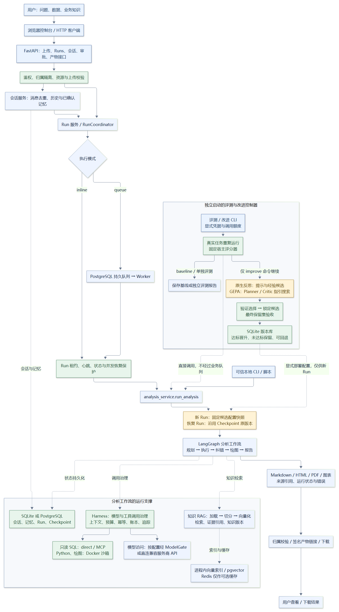
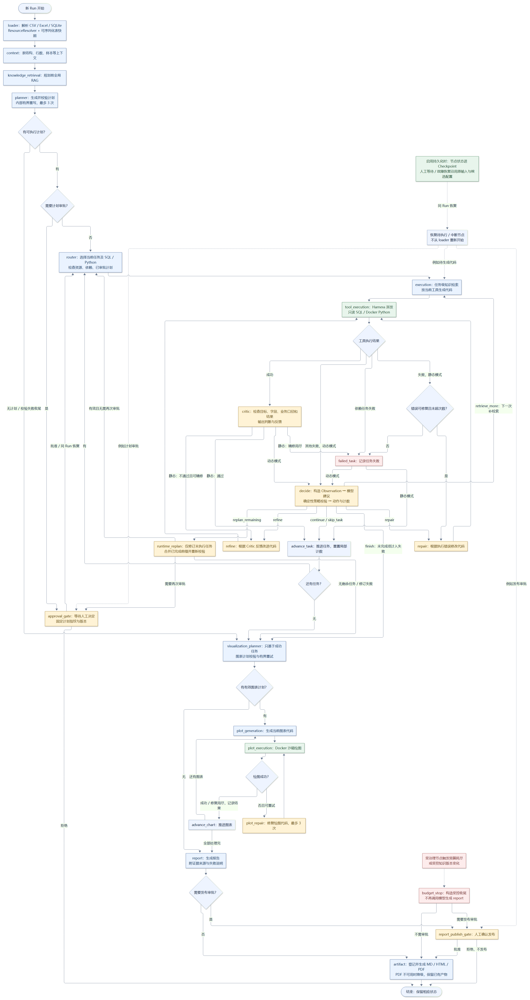
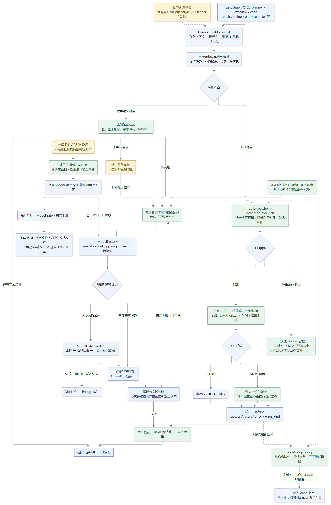
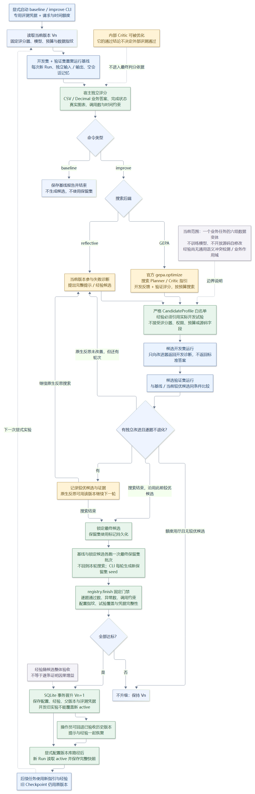

# InsightFlow 完整项目流程图

按 2026-10-25 当前代码绘制。范围是正在开发的 `insightflow-agent2`，包含可选 ModelGate、数据库/缓存、会话/记忆、Harness、审批与恢复，以及新增的独立评测和提示/经验优化。旧版 `insightflow-agent` 与参考仓库不是当前主工作流的运行节点。

[打开可缩放的完整图册](project-flow.html)

实线表示主要执行或数据路径；虚线表示支撑依赖、配置注入或说明，不表示所有节点都必须顺序经过。

## 1. 系统总览

[矢量 SVG](project-overview.svg) · [可编辑 Mermaid 源码](project-overview.mmd) · [Mermaid 预览](project-overview.md)

API 请求经鉴权、归属与资源检查，再进入会话或 Run 编排；可信 CLI 可直接调用分析服务。inline 和 queue/worker 最终调用同一个分析工作流。ModelGate 是按模型地址配置选择的网关，不是硬编码的必经服务。

## 2. 一次分析的完整流程

[矢量 SVG](analysis-workflow.svg) · [可编辑 Mermaid 源码](analysis-workflow.mmd) · [Mermaid 预览](analysis-workflow.md)

- Planner 内部完成结构/授权/依赖校验及有界重写；它不是独立的 LangGraph 重规划节点。
- 动态模式先收集执行/审查观察，再由模型建议动作、确定性策略校验。静态模式直接走固定 Repair/Refine 分支。
- `retrieve_more` 回到 execution，由其依据 retrieval_focus 补检索，再生成代码。
- 计划审批或发布审批拒绝，直接结束，不生成新的交付物。
- budget_stop 自行构造受控收尾，直接去发布审批或 artifact，不再次调用 report 模型。
- Plot 修复用尽时记录失败并推进；报告只引用成功图表，PDF 不可用可降级为已有 Markdown/HTML。
- 图中展示受控路径；未捕获异常还会由 Coordinator 登记失败状态，Checkpoint 支持受约束恢复。

## 3. Harness 与调用治理

[矢量 SVG](harness-governance.svg) · [可编辑 Mermaid 源码](harness-governance.mmd) · [Mermaid 预览](harness-governance.md)

任务内模型/工具调用由 Harness 治理；SQL direct/MCP 共用只读防护，Python/绘图使用 Docker 沙箱。动作合法性位于相邻的 agent_loop.policy，并不由模型自行决定。会话、记忆、知识索引等状态可用 SQLite/进程内或 PostgreSQL/pgvector；Redis 仅作为缓存，不能替代权威持久化。

外层候选提案和 GEPA 反思使用独立 CallAllowance 与模型工厂，目前没有全部接入任务内完整幂等账本。新经验只直接注入 Planner/Critic；它不修改权限、预算、评分器或工具白名单。

## 4. 独立评测与自我改进

[矢量 SVG](evaluation-improvement.svg) · [可编辑 Mermaid 源码](evaluation-improvement.mmd) · [Mermaid 预览](evaluation-improvement.md)

评测和改进由命令显式启动，不会在每次普通会话后自动训练或改写系统。评测 CLI 直接调用分析服务，不经过业务队列。候选只允许纯文本指引与有来源的经验；内部 Critic 可优化，宿主独立评分规则固定。

GEPA 内部自行搜索；外层验证最终候选。原生反思在轮次额度内可使用较优版本继续生成候选。验证选择结束后锁定版本，基线与候选各运行保留集批次，完成固定门禁再事务切换 active。失败保留旧版本；显式配置部署注册表后，新 Run 读取 active，旧 Checkpoint 固定原配置。

当前评测只覆盖一个业务任务的六组同领域数据变体；经验尚未实现通用语义冲突检测和业务作用域。源码自修改未开启，也未用真实付费模型证明改进收益。

## 源码核对入口

- `workflow.py`、`nodes.py`、`conditions.py`：分析节点、内部校验与路由。
- `api*.py`、`services/run_coordinator.py`、`services/conversation_service.py`：入口、队列与执行租约。
- `harness/`、`agent_loop/`、`sandbox/`、`mcp_bridge/`：调用治理、动作与执行边界。
- `rag/`、`storage/`、`core/checkpoints.py`：知识、持久化与恢复。
- `eval/real_runner.py`、`improvement/`、`scripts/run_improvement.py`：独立评测、候选搜索与晋升。
- `../modelgate-original/app/api/routes/chat.py`：可选模型网关的鉴权、路由、并发、配额与用量落库。
